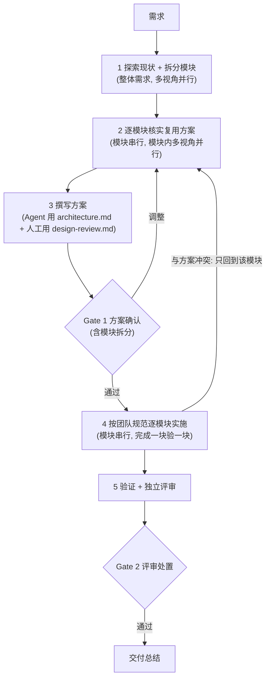

# feature-dev-codex v3 改造设计（待评审）

> 状态：已确认，按批次实施中（第 1–4 批已完成，待统一测试）。已并入对 spec-kit 的借鉴（2.6 节）。测试安排：整版（第 0–4 批）完成后统一测试，批次之间不单独测试。
> 读法：先看 1、2 节理解新流程，再看第 6 节需要你拍板的事项；3–5 节是落地细节，按需查阅。

## 0. 一句话概要

把现有"七阶段 + 三个审批门 + 按视角出整套方案"改成"五步 + 两个审批门 + **先拆模块，每个模块内多视角并行**"，并让方案文档同时产出一份给人读的中文评审稿。模块之间串行处理，目的不是提速，而是让每次只解决一个小问题。

## 1. 新流程

| 步骤 | 做什么 | 主要产物 |
| --- | --- | --- |
| 1 | 写清用户操作、预期结果、约束；查看入口与调用链；拆成模块，写明每块的职责、依赖、验收场景、需共同确认的约定 | `task_plan.md`（模块表）、`findings.md` |
| 2 | 对每个模块依次确认：仓库里能复用什么 → 公开成熟实践怎么做 → 才轮到新设计 | `findings.md`（按模块的复用对照表） |
| 3 | 汇总成方案并交给人评审 | `architecture.md`、`design-review.md` |
| 4 | 先声明适用规范、参考实现、预计改动的包和文件，再实施；一块一验 | 代码、`progress.md` |
| 5 | 模块验收 → 跨模块主流程 → 检查已有调用方和测试 → 独立评审 | `review.md` |

与旧版对照：旧 Phase 1–3 合并为步骤 1–2；旧 Phase 4 并入步骤 2–3；旧 Gate A/B 合并为 Gate 1；旧 Gate C 改名 Gate 2。需求不清时，Agent 可在步骤 1 随时向你提问，这属于澄清，不占审批门。

## 2. 关键机制

### 2.1 模块串行，模块内多视角并行

保留多视角，但视角用在**单个模块**上，而不是对整个需求各出一套完整方案：

| 位置 | 视角（并行） | 说明 |
| --- | --- | --- |
| 步骤 1，整体需求 | 入口与调用链 / 相似功能与可复用实现 / 规范与测试边界 | 目的是拆得对，输出供编排者拆模块 |
| 步骤 2，每个模块 | explorer：该模块的现有实现与约定；researcher：公开实践（仅在属于通用技术问题时启用） | 先拿证据 |
| 步骤 2，有真实设计取舍的模块 | architect 多视角：最简复用 / 可维护 / 风险兼容 | 只给该模块的建议，不出整需求方案 |

- 子 Agent 数量随模块不确定性缩放：纯复用的模块只开 1 个 explorer，不开 architect；有取舍的模块才开多视角。高风险任务仍然三视角。
- 后面的模块能看到前面模块已定的结论和接口约定，保证一致。
- architect 输出限制：1 个推荐加至多 1 个备选；必须写"为什么不更简单"和"明确不做"；必须引用 `findings.md` 里的复用依据。

### 2.2 复用优先，顺序固定

1. 仓库现有实现：接口地址怎么配、HTTP 怎么调、响应怎么解析、异常怎么处理。
2. 公开成熟实践和官方文档：核对适用条件，再结合项目约束取舍。
3. 都不满足才新设计，并说明为什么前两条走不通。

联网检索只搜通用技术问题，搜索词里不放项目名、公司名和业务细节。来源优先级：官方文档 > 成熟开源项目 > 高质量技术文章；必须记录链接和访问日期。

### 2.3 规范来源

先找已成文的规则：`docs/coding-styles`、`AGENTS.md`、`CLAUDE.md`、`CONTRIBUTING.md` 等。**找到就直接用，并在步骤 4 开头声明引用了哪些**；**找不到才**生成"项目约定卡" `.planning/conventions.md`（包结构、分层、命名、异常与响应模型、HTTP 工具、测试写法，每项附样例文件路径）。约定卡是项目级文件，跨需求复用，建议让团队老同事看一眼。

### 2.4 两份方案文档

| | `architecture.md`（Agent 用） | `design-review.md`（人评阅，固定中文） |
| --- | --- | --- |
| 风格 | 结构化、按模块、字段固定，便于后续步骤精确引用 | 叙述式，面向没看过代码的评审人 |
| 内容 | 每模块：决策、复用依据、文件改动清单、测试、待确认项 | 见下 |

`design-review.md` 章节顺序（评审人先理解、后决策）：

1. 一句话概要：做什么、拆几块、需要你决定几件事
2. 用户流程与预期行为（复杂时配 Mermaid）
3. 必要的技术背景（只讲做决策需要的）
4. 各模块方案：做什么 / 推荐做法 / 参考依据（代码路径或公开来源链接）/ 影响范围 / 验收场景（Given/When/Then）/ 独立验证方式
5. 待决策清单：每项给出问题、为什么重要、选项、推荐及理由、不选的代价
6. 明确不做什么，以及"复杂度说明表"（见 2.6）
7. 附录：字段、键名、时序、接口细节

最终方案只保留已选方案和具体路径，备选方案只出现在待决策清单里。

自检清单（写在模板末尾，Agent 交付前逐条核对）：
- 只读 2、3、5 能否做出决策
- 有无未解释术语，同一概念的叫法是否一致
- 每个决策点是否有推荐
- 每个新增组件是否在复杂度说明表里回答了"为什么不更简单"
- 每个验收场景是否都有对应的模块方案和文件改动，每个模块方案是否都对应某个验收场景
- 方案是否符合仓库规则或约定卡
- 是否还有未清零的 `[NEEDS CLARIFICATION]`
- 正文（不含附录）篇幅是否在上限内（约 3000 字，可根据实际情况调整；超出时先删减而不是扩写）

### 2.5 其他机制

- **防过度设计**：除 2.1、2.4 的约束外，reviewer 增加检查项"引入了未经批准的复杂度，或有现成实现却另起一套"。
- **回流**：步骤 4 发现方案不成立，只回到对应模块的步骤 2，改动该模块方案并说明对其他模块的影响，不整体推倒。
- **分级**：保留 simple / medium / high，但判据改为模块数量、是否有现成参考实现、是否含通用技术问题，加上原有的高风险清单。simple 任务可不走全流程；拿不准按 high 处理。
- **语言**：Skill 指令保持英文（与现有一致，模型遵循更稳）；面向人的文档固定中文；`.planning` 里 Agent 用的文件内容跟随用户语言。

### 2.6 借鉴 spec-kit

参考了 [github/spec-kit](https://github.com/github/spec-kit) 的流程和模板（读的是网页摘要，写入模板前再核对原文措辞）。它偏从零开始的新项目，没有"先复用仓库现有实现"和"联网查公开实践"这两环，文档产物也多，整体不照搬，只取下面这些小机制：

| 借鉴点 | spec-kit 的做法 | 我们的落点 |
| --- | --- | --- |
| 复杂度说明表 | 偏离简单方案时填三列：违反了什么 / 为什么需要 / 为什么更简单的方案被否 | 方案里每个新增组件、存储、抽象都要填；写进 `design-review.md` 第 6 节和 `architecture.md` |
| 删光未选项 | 最终计划不留 "Option" 标签，只留具体路径 | 见 2.4 |
| 显式标出不确定 | `[NEEDS CLARIFICATION: …]` 标记，不让 AI 编造 | 所有模板使用；Gate 1 前清零，或带进决策清单 |
| 澄清提问协议 | 最多 5 问、一次一问、按"影响×不确定性"排序、每问带"为什么重要"和"推荐 + 理由"、不影响实现和测试的不问、答案记入日志 | 编排 SKILL.md 的步骤 1；答案记入 `task_plan.md` 的澄清日志；决策清单沿用同样格式 |
| 一致性自检 | `analyze` 只读检查需求↔任务覆盖、术语漂移 | 并入 2.4 的自检清单，不新增 Agent |
| 三态验证 | 只有 `verified` 才算成功，其余为 `partial` / `failed` | 步骤 4 的模块状态 |
| 带理由停止 | `go / needs-clarification / kill`，停止并记录原因也是有效结果 | 步骤 1：发现仓库已满足需求时，记录依据并停止 |
| 验收场景写法 | 用户故事分优先级、可独立测试，验收用 Given/When/Then | 模块的验收场景用 GWT，模块另写"独立验证方式" |
| 设计后复核 | 约束检查在调研前和设计后各做一次 | 步骤 3 交付前复核"是否符合仓库规则或约定卡"（已在自检清单里） |

不借鉴：单独的 `tasks.md`、`data-model.md`、`quickstart.md`、`contracts/`（文档已够多，有模块表和文件改动清单）；constitution 驱动的整套门禁；extensions / presets / hooks / catalog / CLI（平台化机制，对本插件是过度设计）；spec 模板的"不写实现细节"（我们的评审稿需要讲必要的技术背景）。

## 3. 改动清单

| 文件 | 改动 |
| --- | --- |
| `skills/feature-dev-codex/SKILL.md` | 重写为五步 + 两个审批门 + 分级 + 回流 + 规范来源；`workflow-version` 升为 3；超过约 6KB 的细节拆到 `references/`。第 2 批补：步骤 1 澄清协议与带理由停止、模块三态；澄清细则拆到 `references/clarification.md` |
| `skills/feature-dev-code-explorer/SKILL.md` | 增加"可复用实现清单"和"规范提取"，输入改为（模块, 视角） |
| `skills/feature-dev-code-researcher/SKILL.md` | **新增**：只读；输出问题、来源（链接 + 类型 + 日期）、结论、适用条件核对、与本项目约束的差异、推荐 |
| `skills/feature-dev-code-architect/SKILL.md` | 改为按模块；输出限制见 2.1 |
| `skills/feature-dev-code-reviewer/SKILL.md` | 增加"约定符合度"和"过度设计"检查，Gate C 改名 Gate 2，OCR 优先加原生 Git 回退的主体逻辑不动 |
| `templates/task_plan.md` | 改为五步、模块表、两个审批门；第 2 批补澄清日志、模块验证三态、GWT 验收场景和"独立验证方式" |
| `templates/findings.md` | 按模块的"复用对照表"（复用 / 扩展 / 新增 + 依据） |
| `templates/architecture.md` | 改为按模块的决策记录，含复杂度说明表，不留未选项 |
| `templates/design-review.md` | **新增**，见 2.4 和 2.6 |
| `templates/conventions.md` | **新增**，仅在无成文规范时使用 |
| `templates/review.md`、`progress.md` | 审批门命名同步 |
| `plugin.json`、`README.md`、`README-En.md`、`ATTRIBUTION.md` | 版本、描述和流程说明同步 |

## 4. 验收用例

两个用例都用你已经遇到过的真实场景。基线优先用当时已有的产物（验证码那份过度设计的方案还在的话直接拿来用），省一次重跑。

| 用例 | 通过标准 |
| --- | --- |
| 验证码 | ① 识别为通用技术问题并联网检索；② 结论为 Redis 短期存储、不持久化、不引入 OTP 体系，并写进"明确不做"；③ 发码、验码、核销路径引用公开实践且带来源链接；④ 有效期、可用次数、失败后用户看到什么，用业务语言写清楚 |
| 教师/学生列表 | ① 步骤 2 找到仓库已有的同类实现（外部接口 URL 配置、调用方式、异常处理）；② 判定为"复用/扩展"，没有另起并行实现；③ 新代码落在同类实现所在的包和职责下；④ 异常处理与现有一致 |

通用度量（前后对比）：评审文档正文篇幅、有无多余的持久化或新组件、复用是否命中、评审人 10 分钟内能否基于文档做出决策（人工判断）、实施代码落点是否符合约定。

这些用例必须在你的工作仓库里跑，我这边没有那个仓库。

## 5. 实施顺序

按批次改，批次之间不单独测试；第 4 批完成后统一跑第 4 节的用例。

| 批次 | 内容 | 状态 |
| --- | --- | --- |
| 0 | 保存基线产物 | 你来做；验证码基线需保留 |
| 1 | 流程骨架：编排 SKILL.md、`task_plan.md`、explorer、researcher、architect、`findings.md`、`dispatch.md` | 已完成 |
| 2 | 方案文档：`architecture.md`、`design-review.md`、复杂度说明表、自检清单；并入 2.6 的编排小补丁（澄清协议、带理由停止、模块三态）和 `task_plan.md` 补充 | 已完成 |
| 3 | 实施与评审：步骤 4–5 细化、reviewer 增量（约定符合度、过度设计、Gate 2 命名）、`conventions.md`、`review.md` / `progress.md` 命名同步 | 已完成 |
| 4 | 收尾：README 中英文、`plugin.json` 版本（0.3.0）和描述、`ATTRIBUTION.md`（注明借鉴 spec-kit） | 已完成 |
| 5 | 统一测试：重新安装，检查 skill 被识别；跑验证码和教师/学生列表两个用例，对照第 4 节通过标准，填写 `docs/eval-cases.md` 记录表 | 第 4 批后 |

## 6. 待你拍板

| # | 问题 | 推荐 | 不选的代价 |
| --- | --- | --- | --- |
| 1 | 子 Agent 数量按模块复杂度缩放（纯复用模块只开 1 个） | 缩放 | 每个模块都开满多视角：成本和耗时倍增，且纯复用模块没有设计可争论 |
| 2 | 版本号 | 升 `0.3.0`，`workflow-version: 3` | 作为 `0.2.x` 小版本发布：流程发生破坏性变化，旧用户升级后行为突变 |
| 3 | 评审稿正文篇幅上限 | 约 3000 字，可根据实际情况调整 | 不设上限：回到"文档又长又难评审" |
| 4 | 约定卡存放位置 | `.planning/conventions.md`（项目级，跨需求复用） | 放在各需求目录下：每个需求都要重新生成 |
| 5 | 验收用例放哪 | 本仓库新增 `docs/eval-cases.md`，只存用例描述和通过标准，不含业务代码 | 不留档：下次改插件无法回归验证 |
